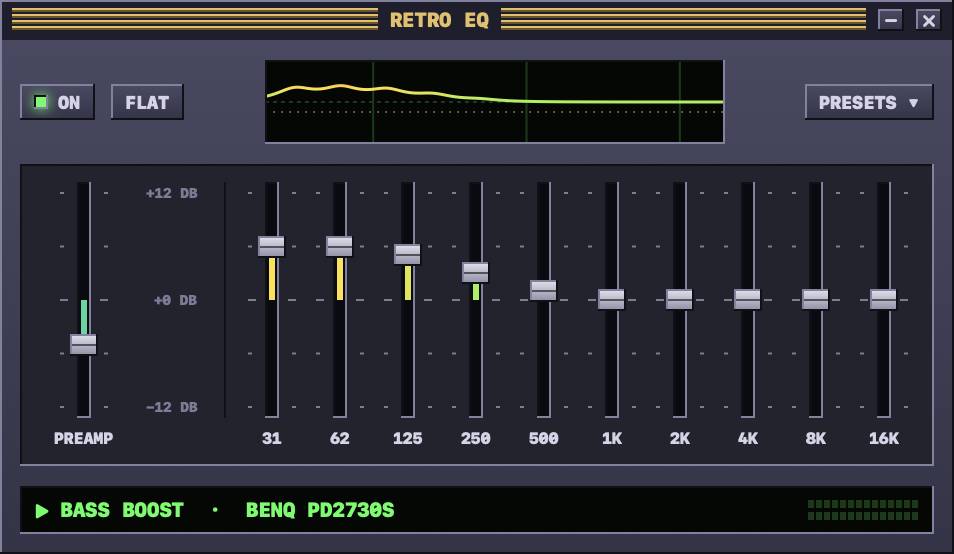

# RetroEQ

RetroEQ is a system-wide 10-band graphic equalizer for macOS with a late-90s media-player look. It applies to all audio the Mac plays and requires no audio driver.



## Requirements

- macOS 15 or later
- Xcode command-line tools (Swift 6)

## How it works

RetroEQ uses the Core Audio process-tap API (macOS 14.2 and later):

1. A global stereo tap captures the output of every process except RetroEQ and mutes the original signal while the tap is read.
2. A private aggregate device combines the tap with the current default output device.
3. An IOProc written in C runs the tapped audio through ten peaking filters, a preamp and a soft-knee limiter, and writes the result to the output device.

The C IOProc keeps the Swift runtime off the real-time audio thread. When the default output device or its sample rate changes, RetroEQ rebuilds the tap and aggregate device. When the equalizer is off or RetroEQ quits, the tap is destroyed and audio plays through the normal path.

## Bands and presets

The bands are ISO octave bands: 31, 62, 125, 250, 500, 1K, 2K, 4K, 8K and 16K Hz, each ±12 dB. The preamp is ±12 dB.

Presets include Bass Boost, Laptop Bass, Deep Bass, Bass & Treble, Loudness, Rock, Pop, Hip-Hop, Electronic, Dance, Jazz, Classical, Acoustic, Vocal, Treble Boost and Late Night. Small speakers cannot reproduce 31–62 Hz, so Laptop Bass boosts 125–250 Hz instead.

## Building

```sh
./build.sh            # builds build/RetroEQ.app
./build.sh --install  # also copies it to /Applications
```

`build.sh` signs the app with the first valid identity for `TEAM_ID`, in this order:

1. A Developer ID Application certificate. The script signs with the hardened runtime. If `NOTARY_PROFILE` names a `notarytool` keychain profile, the script also notarizes the app and staples the ticket.
2. An Apple Development certificate. The app runs on the Mac that built it, but Gatekeeper rejects it on other Macs.
3. Ad-hoc signing, when no certificate for the team exists.

Set `TEAM_ID` to another team, or set `SIGN_IDENTITY` to a certificate hash, to override the selection.

To create a notarization profile:

```sh
xcrun notarytool store-credentials RetroEQ --apple-id <apple-id> --team-id <team-id>
NOTARY_PROFILE=RetroEQ ./build.sh --install
```

## Permissions

On first start, macOS asks for permission to record system audio. If the permission is denied, the tap delivers silence and audio is muted while the equalizer is on. To grant it later, open System Settings → Privacy & Security → Screen & System Audio Recording.

## Using it

- Drag a slider to set a band. Option-click a slider to reset it to 0 dB.
- **ON** turns the equalizer on and off. **FLAT** resets all bands. **PRESETS** opens the preset list.
- The close button hides the window. The equalizer keeps running, and the menu bar icon reopens the window, changes the preset, sets Launch at Login and quits the app.

## Self-test

`Scripts/selftest.sh` quits RetroEQ, then runs the installed app in test mode. The test drives the menu bar items and plays quiet tones through the live tap. It compares the equalizer's input and output at 62 Hz and 1 kHz under the Flat and Bass Boost presets, hides the window and measures again. Afterwards it restores the saved settings and reopens RetroEQ.
